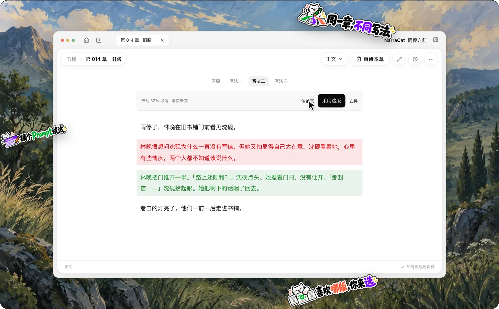
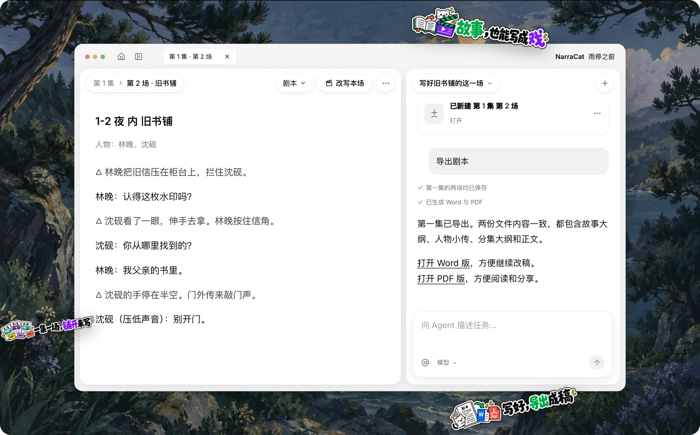

# NarraCat Pro

**故事生于人，成于智能。**

NarraCat Pro 是面向长篇小说与短剧的 AI 创作引擎。 
你负责立意与取舍，它负责结构、推进与记忆—— 
让那个一直没写完的故事，从一念起笔，一路写到完结，而不在中途崩坏设定。

[**下载 Mac 版**](https://pro-update.narracat.com/mac-arm64/latest.dmg) ·
[**下载 Windows 版**](https://pro-update.narracat.com/win-x64/latest.exe) ·
[官网](https://narracat.com) ·
[更新记录](https://github.com/the-lumos-labs/narracat-pro-releases/releases)

公开内测中 · Apple 芯片 Mac（macOS 12 及以上）· Windows 10 / 11（64 位）

---

## 它能和你一起做什么

### 对话协作 —— 说说你的想法，一起把故事写下去

聊情节、理大纲、写正文，也能随时提出修改。NarraCat 结合你的作品，把讨论中的想法落实到稿子里。你继续提意见，一起把故事打磨成想要的样子。

### 故事记忆 —— 下一章，带着前面的故事一起写

人物经历了什么，关系怎样变化，还有哪些伏笔等待回应。NarraCat 结合前文与故事记忆，辅助续写、修改和前后衔接检查，减少你反复补充背景的负担。

### 写作偏好 —— 你的写作习惯，也能成为它的方法

对白怎么写，打斗怎么展开，哪些表达尽量避免——把偏好告诉 NarraCat，也可以把反复打磨的方法整理成写作技能，用在这本书，或以后的创作里。

### 文风对比 —— 哪种写法更对味，放在一起比比看

同一章原稿，试试不同的提示词与模型。对照几版文字的节奏、对白和表达，挑选更合心意的一版采用，找到适合这本书的写法。

### 唠个嗑 —— 和你笔下的角色聊聊

写累了，找笔下的人物聊聊。以角色设定和已完成的剧情为基础，听他谈经历、聊心事，也问问他为什么做出那个选择。

### 短剧创作（试用） —— 从一个点子，写到一场场戏

除了小说，也能和 NarraCat 一起写短剧。从故事构想、分集梗概，到每一场的动作与对白，逐步推进剧本，并将已完成的内容导出为 Word 或 PDF。

---

## 三步开始写

**1. 下载安装**

| 系统 | 下载 | 第一次打开 |
|---|---|---|
| Mac（Apple 芯片，macOS 12 及以上） | [NarraCat Pro.dmg](https://pro-update.narracat.com/mac-arm64/latest.dmg) | 已签名并通过 Apple 公证，拖进「应用程序」后双击打开 |
| Windows 10 / 11（64 位） | [NarraCat Pro 安装程序.exe](https://pro-update.narracat.com/win-x64/latest.exe) | 内测版安装包**还没有代码签名**，第一次运行会出现蓝色的「Windows 已保护你的电脑」，点 **「更多信息」→「仍要运行」** 即可 |

暂不支持 Intel 芯片的 Mac 和 Linux。上面两个链接始终指向最新版本。

**2. 接通模型服务**

NarraCat Pro 使用你自己的模型服务账号（自带 API Key），写作内容直接发给你选的服务，不经过我们。内置 DeepSeek、Kimi、MiniMax、OpenAI、Anthropic、OpenRouter；兼容 OpenAI 或 Anthropic 接口的服务（包括本地部署的模型）也可以在「自定义」里接入。

第一次用推荐 DeepSeek：注册、充值、创建 API Key，几分钟就能好。API Key 存进系统凭据库（Mac 钥匙串 / Windows 凭据管理器），不写成明文文件。

**3. 开一部作品**

在书架上新建一部小说或短剧剧本，和 Agent 聊聊你想写的故事，从立项、大纲到第一章，一步步写下去。

---

## 用过开源版 NarraCat？

- 两个应用可以装在同一台电脑上，各用各的数据，互不影响。
- NarraCat Pro 第一次启动时，会问你要不要导入开源版的书架。导入是**复制**一份进 NarraCat Pro，原来的作品一个字节都不会改，开源版照常能打开。
- API Key 不会自动带过来，导入后在 NarraCat Pro 里重新填一次。

## 更新

NarraCat Pro 会在后台检查并下载新版本，退出 App 时自动装好；想马上用新版，可以在「设置 → 关于 → 软件更新」里重启更新。不需要重新下载安装包。每一版改了什么，见 [Releases](https://github.com/the-lumos-labs/narracat-pro-releases/releases)。

## 你的作品与隐私

- 作品保存在你自己的电脑上，是书架位置里的普通文件夹，可以直接备份、移动。我们不在自己的服务器上保存你的作品和 API Key。
- 写作时，内容直接发到你自己配置的模型服务，不经过我们。
- 「体验改进计划」只分享匿名的使用情况，不含你写的任何内容。第一次启动会先告诉你，选择之前一条数据都不会发出，之后随时可以在设置里退出。

每一处联网发什么、发给谁、能不能关，逐项写在 [隐私说明](PRIVACY.md)。

## 反馈

| 渠道 | 谁能看到 | 适合 |
|---|---|---|
| App 里的「设置 → 关于 → 报告问题」 | 只有维护者 | 出错、闪退、写作结果不对。会附上最近的运行日志（已去掉用户目录和常见格式的 Key），发送前可以预览 |
| 本仓库的 [Issues](https://github.com/the-lumos-labs/narracat-pro-releases/issues) | 所有人 | 功能建议、使用讨论。**这里是公开的，请不要贴未发表的正文和 API Key** |

## AI 生成内容声明

- 用 NarraCat Pro 写出的内容，权利与责任归你。
- 各平台对 AI 辅助创作有各自的规则，投稿或发布前请先确认。

## 关于这个仓库

这里只放 NarraCat Pro 的安装包与更新清单，不放源码。NarraCat Pro 是专有软件，保留所有权利；随安装包附带的第三方许可声明，可以在 App 的「关于 → 开源许可」中查看。

开源版 [NarraCat](https://github.com/yannikzz/narracat-novel-agent) 以 AGPL-3.0 许可继续公开维护。
